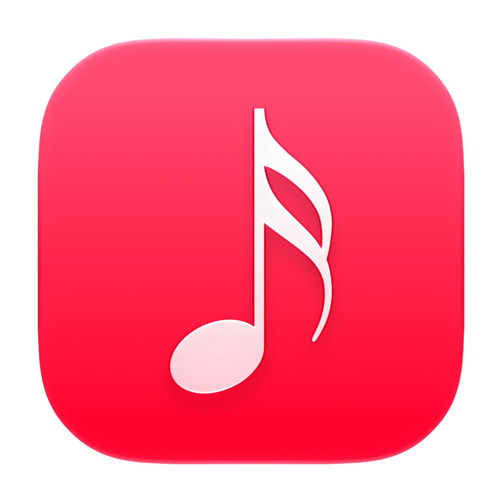

<div align="center">
  
  <h1>Dawn FM</h1>
  <p><strong>A fast, lightweight, native YouTube Music player for macOS</strong></p>
  <p>No Electron, no web wrapper. Ultra-light on memory, instant playback, and native design.</p>

  <p>
    <a href="https://github.com/wenujacodes/DawnFM/releases/latest"></a>
    
    
    <a href="LICENSE"></a>
  </p>


  <p>⭐ <em>Star the repo to help others discover Dawn FM!</em></p>
</div>

---

## Screenshots

<table>
  <tr>
    <td width="50%"></td>
    <td width="50%"></td>
  </tr>
  <tr>
    <td align="center"><b>Player</b> — artwork, synced lyrics & controls</td>
    <td align="center"><b>Browse</b> — music feeds, charts & library</td>
  </tr>
</table>

## Features

- **Blazing Fast & Native**: Pure Rust UI using [egui](https://github.com/emilk/egui) and [rodio](https://github.com/RustAudio/rodio). Smooth 120 FPS animations with low CPU/RAM footprint.
- **Synced Karaoke Lyrics**: Smooth syllable-by-syllable & timed lyrics with dynamic artwork-matched typography.
- **Lossless & Spatial Audio**: Hi-Res Lossless and Dolby Atmos playback support with automatic fallback to YouTube audio.
- **Seamless Playback**: Smart DJ-style automix, crossfade, and zero-latency track prefetching.
- **Offline Downloads**: Save tracks and playlists locally for offline listening.
- **Desktop Integrations**: macOS media keys, Now Playing widget, Dock menu, Discord Rich Presence, and Last.fm scrobbling.
- **Library & Jam**: Google sign-in for full library synchronization and real-time Listen Together jam rooms.

## Privacy

Dawn FM is private and local-first:
- **Zero Telemetry**: No analytics, user profiling, or third-party tracking scripts.
- **Direct Connections**: All requests connect directly to YouTube Music and configured sources.
- **Encrypted Storage**: Sensitive sign-in credentials are saved directly in your encrypted macOS Keychain.

## Installation

1. Download the latest `.dmg` from [Releases](https://github.com/wenujacodes/DawnFM/releases/latest).
2. Open the disk image and drag **Dawn FM** into `/Applications`.
3. *First launch on macOS*: Right-click **Dawn FM** and select **Open** (or run `xattr -dr com.apple.quarantine "/Applications/Dawn FM.app"` in Terminal).

## Building from source

Requires the [Rust toolchain](https://rustup.rs/):

```sh
git clone https://github.com/wenujacodes/DawnFM.git
cd DawnFM
cargo build --release
sh macos/bundle.sh target/release/dawnfm 2.2.0 out
```

The signed bundle will be located at `out/Dawn FM.app`.

## Contributing

Please open an issue first, then a PR that closes it. See [CONTRIBUTING.md](CONTRIBUTING.md).

## License & Credits

Dawn FM is licensed under [GPL-3.0](LICENSE).  
Based on [BitChord-PC-Continued](https://github.com/jackychan4891/BitChord-PC-Continued) by **[jackychan4891](https://github.com/jackychan4891)**.
